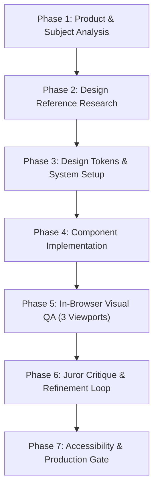

# Professional AI Design & Frontend Engineering Workflow

This workflow documents the end-to-end design and engineering process executed inside Google Antigravity IDE.
Follow these 7 sequential phases for any new feature, page, or application build.

---

## The 7-Phase Execution Pipeline



---

## Phase 1: Product & Subject Analysis

Never start writing UI code before clarifying the core product fundamentals:
1. **The Product:** What does this software actually do? (e.g. AI-powered short-form video generation from long podcasts).
2. **The Target Audience:** Who is using this? (Solo content creators, agency video editors, marketing teams).
3. **The Business Purpose:** What is the primary conversion goal or operational action? (Exporting a reel, upgrading to Pro, editing captions).
4. **The Aesthetic Personality:** What mood should it convey? (Precision studio tool, calm fintech terminal, editorial publication, bold consumer creator app).

---

## Phase 2: Design Reference Research

Before creating layouts, examine real-world benchmarks from elite product design galleries:
- **Mobbin (`mobbin.com`):** World-class mobile and web application workflows, paywalls, onboarding flows, and settings screens.
- **Godly (`godly.website`):** High-taste web design, typography-driven layouts, and unique brand identities.
- **Awwwards (`awwwards.com`):** Site of the Day, cutting-edge interaction design, and creative layouts.
- **Refero (`refero.design`):** Real-world SaaS screens, dashboard tables, filters, and UI patterns.
- **Page Flows (`pageflows.com`):** Verified user journey recordings (signups, upgrades, checkouts).
- **Land-book (`land-book.com`):** Curated product marketing sites and portfolios.

> **Rule:** Do not copy designs blindly. Analyze layout structure, typographic scale, section pacing, and interaction patterns to create an original, bespoke implementation.

---

## Phase 3: Design Tokens & System Setup

Establish the design system foundation before writing layout JSX:
1. Fill out `DESIGN_SYSTEM_TEMPLATE.md` for the project.
2. Define the core color tokens (Ground, Surface, Border, Ink Primary, Ink Muted, Brand, Accent, Status).
3. Select and pair typography (Display face + Interface face + Monospace data face).
4. Enforce the 4px / 8px spatial grid in Tailwind or CSS variables.
5. Create nested border-radius rules ($\text{Radius}_{\text{inner}} = \text{Radius}_{\text{outer}} - \text{Padding}$).

---

## Phase 4: Component Architecture & Implementation

1. **Semantic HTML First:** Use `<button>` for actions, `<a>`/`<Link>` for navigation, `<main>`, `<nav>`, `<aside>`, `<header>`.
2. **Mobile-First CSS:** Write baseline styles for mobile (single column, full-width touch targets), then expand upward with `md:` and `lg:`.
3. **Flexbox Child Safety:** Always add `min-w-0` to flex children that contain truncated or wrapped text.
4. **Implement the 8 UI States:** Default, Hover, Focus-Visible, Active, Disabled, Loading, Empty, and Error.
5. **Animation Restraint:** Apply Emil Kowalski's decision gate. No animations on keyboard shortcuts; snappy `ease-out` curves under 250ms for entrances.

---

## Phase 5: In-Browser Visual QA (Multi-Viewport Inspection)

1. Start the local development server:
   ```bash
   npm run dev
   ```
2. Open a live browser session using Antigravity's `chrome-devtools-plugin` MCP tools or local Playwright runner.
3. Capture full-page screenshots at the 3 standard resolutions:
   - **Desktop:** `1440 x 900 px`
   - **Tablet:** `768 x 1024 px`
   - **Mobile:** `375 x 812 px`
4. Inspect browser console for uncaught errors, 404 assets, and React hydration warnings.

---

## 6. Juror Critique & Refinement Loop

Evaluate the rendered screenshots against the Juror Rubric:
- [ ] Is there an obvious visual anchor, or are elements competing for attention?
- [ ] Are body text lines capped at 65-75 characters (`max-w-[65ch]`)?
- [ ] Are numbers in tables, counters, and timers using `font-variant-numeric: tabular-nums`?
- [ ] Are interactive hit targets at least 44x44px on mobile?
- [ ] Is horizontal overflow completely eliminated on mobile (`overflow-x: clip`)?
- [ ] Does dark mode maintain proper contrast and avoid pitch-black (#000000) surfaces?

Iterate on code, re-capture screenshots, and verify visual fixes.

---

## 7. Accessibility & Production Gate

Perform final sign-off checks:
- [ ] Visible `:focus-visible` rings on all interactive elements.
- [ ] All icon buttons have descriptive `aria-label`.
- [ ] Form inputs are linked to `<label>` elements via `htmlFor`.
- [ ] Modals trap focus and close on `Escape`.
- [ ] Reduced motion media query (`prefers-reduced-motion`) is honored.
